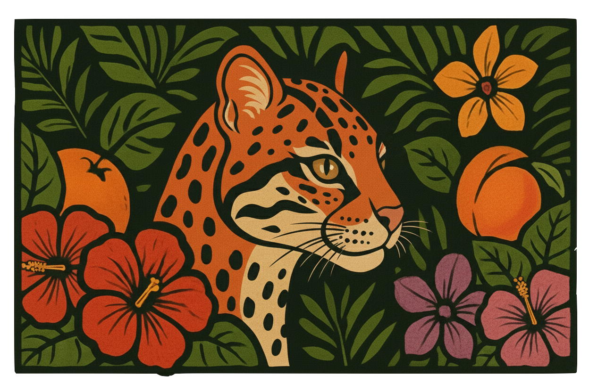

<div align="center">



</div>

```console
pedro@konukoii:~$ whoami --long
──────────────────────────────────────────
name      Pedro Sosa — "The Caribbean Jack of All Trades"
day job   cybersecurity        # pentesting, security tooling
by night  whatever's interesting   # games, AI, art, homelab, old hardware
──────────────────────────────────────────

pedro@konukoii:~$ ls --lab
games:      Ultra Minigolf, Del Playa, Last Ridge, Flow, Paperboy
utilities:  Skadi Hall, Second Brain, Sábado Tarde, Folio, Winnow, Fretwise, Kaupang, Terra
security:   5 [redacted] projects

publishing soon...

pedro@konukoii:~$ _
```

### 🛠️ My Tech Stack

<div align="center">
  
  
  
  
  <br>
  
  
  
  
  <br>
  
  
</div>

<p align="center"><i>🌊 Fueled by sea salt and good vibes 🌊</i></p>
